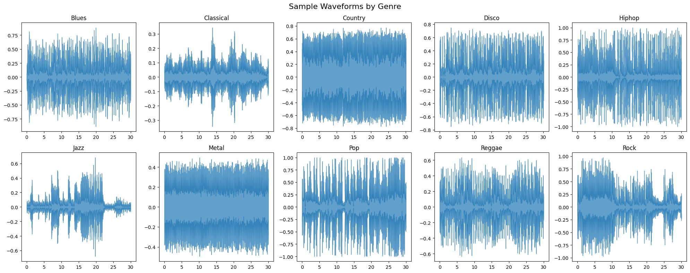
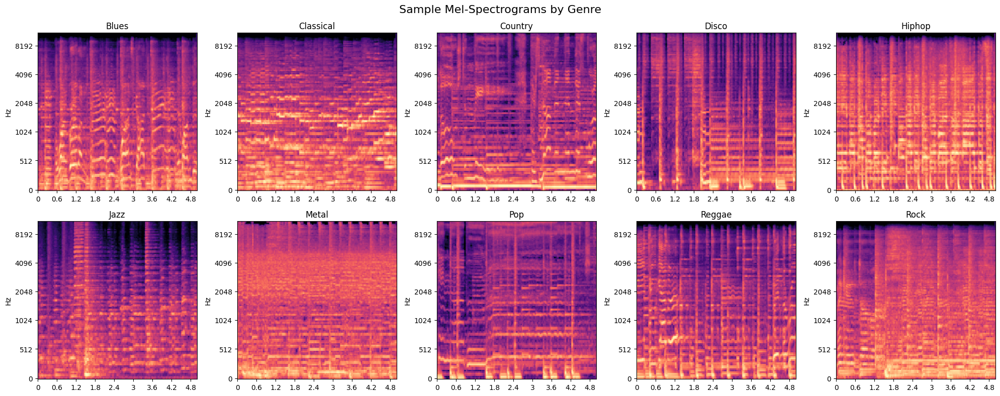
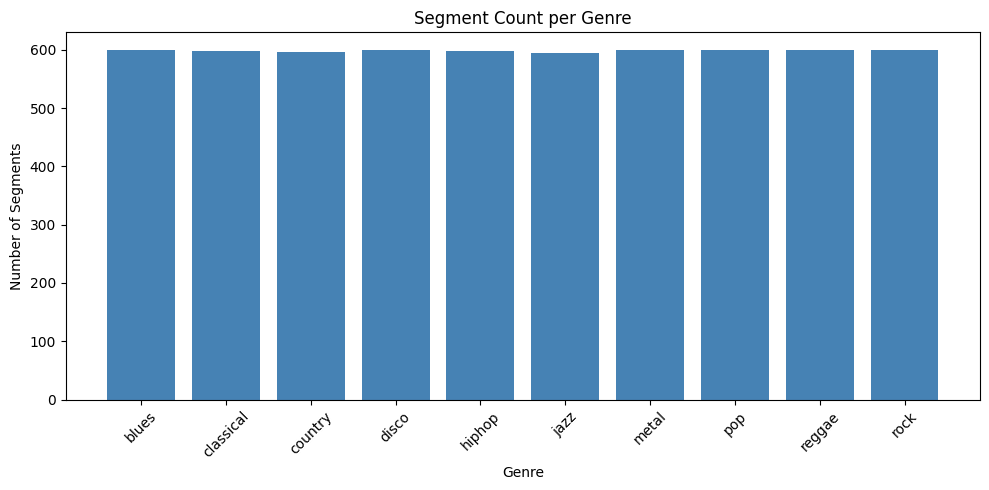
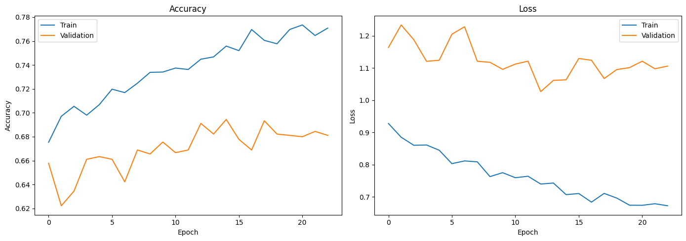
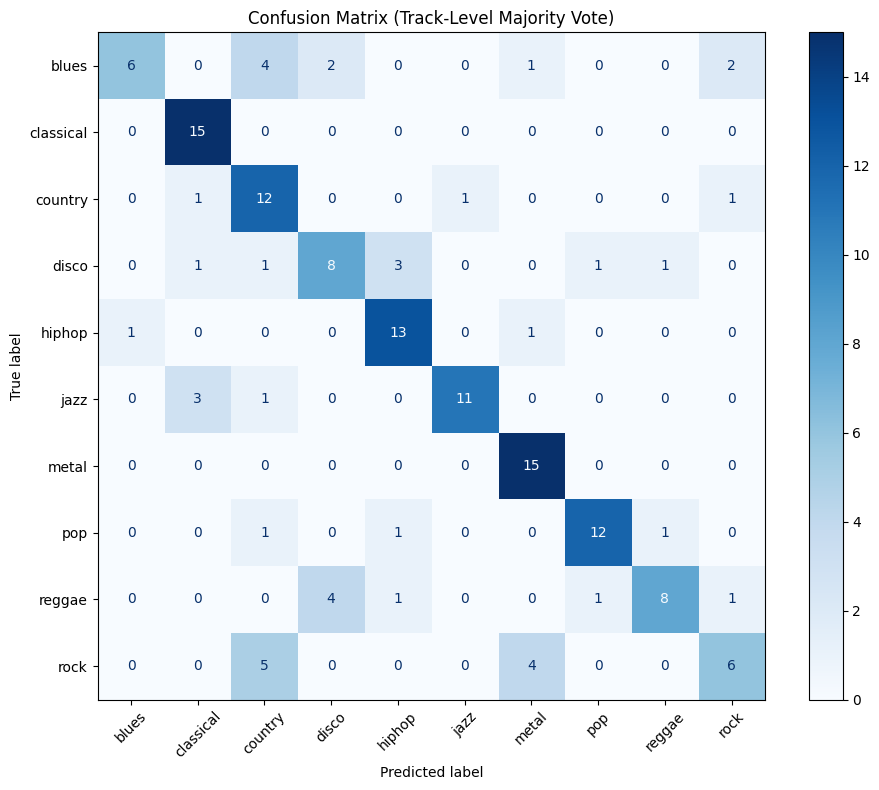

## **Music Genre Classification using CNN**

### 🎯 **Goal**

To classify music tracks into one of 10 genres (blues, classical, country, disco, hip-hop, jazz, metal, pop, reggae, rock) using a Convolutional Neural Network trained on mel-spectrogram representations of audio clips from the GTZAN dataset.

### 🧵 **Dataset**

[GTZAN Dataset — Music Genre Classification](https://www.kaggle.com/datasets/andradaolteanu/gtzan-dataset-music-genre-classification)

- 1000 audio tracks (30 seconds each), 10 genres, 100 tracks per genre
- Originally collected by George Tzanetakis and Perry Cook (2002)
- Each 30s clip is split into 5s segments for training

### 🧾 **Description**

This project converts raw audio waveforms into mel-spectrograms and trains a CNN to classify music genres. The pipeline handles corrupted files, prevents data leakage by splitting on tracks (not segments), and includes a Streamlit web app for interactive predictions.

### 🧮 **What I had done!**

1. Loaded the GTZAN audio files using `librosa`, skipping corrupted files
2. Split each 30-second clip into 5-second segments to increase training data
3. Extracted mel-spectrograms from each segment using `librosa.feature.melspectrogram`
4. Split data into train/test sets **by track** to prevent data leakage
5. Applied SpecAugment (frequency and time masking) for data augmentation
6. Built and trained a 4-block CNN model on the spectrogram images
7. Evaluated the model using accuracy, loss curves, confusion matrix, and track-level majority voting
8. Built a Streamlit web app for interactive genre prediction

### 🚀 **Models Implemented**

| Model | Why chosen |
|-------|-----------|
| **CNN (Convolutional Neural Network)** | CNNs excel at image classification tasks. Mel-spectrograms are 2D representations of audio, making them ideal inputs for convolutional layers that can learn local frequency and temporal patterns. |

### 📚 **Libraries Needed**

- `numpy` — numerical operations
- `pandas` — data manipulation
- `matplotlib` — plotting and visualization
- `librosa` — audio loading and feature extraction
- `scikit-learn` — train/test splitting, metrics, label encoding
- `tensorflow` / `keras` — CNN model building and training
- `streamlit` — interactive web application

### 📊 **Exploratory Data Analysis Results**

| Visualization | Description |
|--------------|-------------|
|  | Sample waveforms from each genre |
|  | Mel-spectrogram examples per genre |
|  | Class distribution (balanced — 100 per genre) |

### 📈 **Performance of the Models based on the Accuracy Scores**

| Model | Segment-level Test Accuracy | Track-level Test Accuracy (Majority Vote) |
|-------|----------------------------|------------------------------------------|
| CNN (4-block with SpecAugment) | 68.41% | **70.67%** |

| Metric | Image |
|--------|-------|
| Accuracy & Loss Curves |  |
| Confusion Matrix |  |

### 📢 **Conclusion**

The CNN achieves **70.67% track-level accuracy** using majority voting across segments, and **68.41% segment-level accuracy** on the GTZAN dataset with proper track-level train/val/test splitting (no data leakage).

- **Classical** (100% recall) and **metal** (100% recall) are the easiest genres to classify due to their distinct spectral signatures.
- **Rock** (40% recall) and **blues** (40% recall) are the hardest, often confused with country and jazz respectively.
- SpecAugment and the 4-block CNN architecture significantly improved generalization over a baseline 3-block model.
- The GTZAN dataset has known limitations including some mislabeled tracks and a small overall size (1000 tracks), so results should be interpreted with that in mind.

### ✒️ **Your Signature**

**tamil123tami**
- GitHub: [tamil123tami](https://github.com/tamil123tami)
